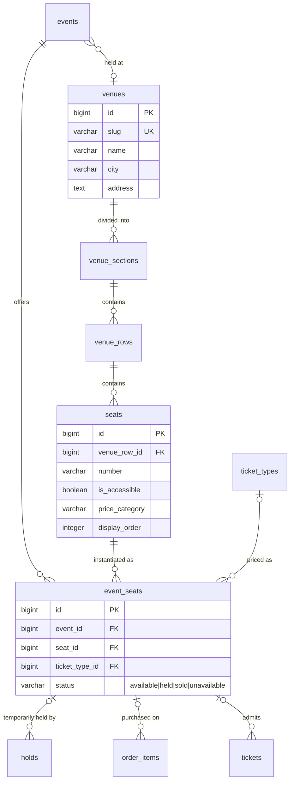

← [07 — Platform](07-platform.md) · [Index](README.md)

# 08 — Assigned Seating *(implemented bonus)*

**Tables:** `venues`, `venue_sections`, `venue_rows`, `seats`, `event_seats`
**Depends on:** [02 — Events](02-events.md), [03 — Ordering](03-ordering.md)
**SRS:** §4.3.1, §7, §8

---

## Status: Implemented

Assigned seating is implemented as an additive extension to the core ordering
and ticketing pipeline, scoped to predefined Kazakhstan venue layouts (starting
with **Palace of the Republic — Main Hall**, Almaty: 3 sections, 7 rows, 66
seats, 4 accessible seats, and 3 price categories: `VIP`, `Premium`, `Standard`).
No visual venue-layout designer or arbitrary venue importer is included (§8).

---

## Diagram

---

## Physical Venue Tables (`app/models/venue.py`)

### `venues`

| Column | Type | Notes |
|---|---|---|
| `id` | bigint PK (`Identity`) | |
| `slug` | varchar(120) UNIQUE | e.g. `palace-of-republic-main-hall` |
| `name` | varchar(300) | e.g. `Palace of the Republic — Main Hall` |
| `city` | varchar(120) | e.g. `Almaty` |
| `address` | text | |
| `created_at` | timestamptz | |

### `venue_sections`

| Column | Type | Notes |
|---|---|---|
| `id` | bigint PK (`Identity`) | |
| `venue_id` | bigint FK (`venues.id`, `ON DELETE CASCADE`) | indexed |
| `name` | varchar(100) | e.g. `VIP Parterre`, `Main Parterre`, `Balcony` |
| `display_order` | integer | default `0` |
| | `UNIQUE (venue_id, name)` | `uq_venue_sections_venue_name` |

### `venue_rows`

| Column | Type | Notes |
|---|---|---|
| `id` | bigint PK (`Identity`) | |
| `venue_section_id` | bigint FK (`venue_sections.id`, `ON DELETE CASCADE`) | indexed |
| `name` | varchar(20) | string label (`"A"`, `"B"`, ...) |
| `display_order` | integer | default `0` |
| | `UNIQUE (venue_section_id, name)` | `uq_venue_rows_section_name` |

### `seats`

| Column | Type | Notes |
|---|---|---|
| `id` | bigint PK (`Identity`) | |
| `venue_row_id` | bigint FK (`venue_rows.id`, `ON DELETE CASCADE`) | indexed |
| `number` | varchar(10) | string seat number (`"1"`..`"10"`) |
| `is_accessible` | boolean | §4.3.1 accessible seats |
| `price_category` | varchar(50) | label (`"VIP"`, `"Premium"`, `"Standard"`) |
| `display_order` | integer | default `0` |
| | `UNIQUE (venue_row_id, number)` | `uq_seats_row_number` |

---

## Sellable Event Inventory (`app/models/seat.py`)

### `event_seats`

| Column | Type | Notes |
|---|---|---|
| `id` | bigint PK (`Identity`) | |
| `event_id` | bigint FK (`events.id`, `ON DELETE CASCADE`) | indexed |
| `seat_id` | bigint FK (`seats.id`) | indexed |
| `ticket_type_id` | bigint FK (`ticket_types.id`, nullable) | NULL only when `status = 'unavailable'` |
| `status` | varchar(20) | `available` \| `held` \| `sold` \| `unavailable` |
| `created_at`, `updated_at` | timestamptz | |

Constraints and indexes:
- `uq_event_seats_event_id_seat_id`: `UNIQUE (event_id, seat_id)`
- `ck_event_seats_status`: `status IN ('available', 'held', 'sold', 'unavailable')`
- `ck_event_seats_sellable_has_type`: `status = 'unavailable' OR ticket_type_id IS NOT NULL`
- `ix_event_seats_event_id_status`: index on `(event_id, status)`

---

## Integration with Events, Holds, Orders, and Tickets

| Table | Added Columns | Constraints / Partial Unique Indexes |
|---|---|---|
| `events` | `venue_id` (FK `venues.id`, nullable), `venue_city` (varchar 120) | `ix_events_venue_id` |
| `holds` | `event_seat_id` (FK `event_seats.id`, nullable) | `ck_holds_seat_quantity_one` (`event_seat_id IS NULL OR quantity = 1`); **`uq_holds_active_event_seat`** partial unique index on `(event_seat_id) WHERE event_seat_id IS NOT NULL AND released_at IS NULL` |
| `order_items` | `event_seat_id` (FK `event_seats.id`, nullable), `section_name`, `row_label`, `seat_number` | `ck_order_items_seat_quantity_one` (`event_seat_id IS NULL OR quantity = 1`) |
| `tickets` | `event_seat_id` (FK `event_seats.id`, nullable), `section_name`, `row_label`, `seat_number` | **`uq_tickets_live_event_seat`** partial unique index on `(event_seat_id) WHERE event_seat_id IS NOT NULL AND status IN ('valid', 'checked_in')` |

Section, row, and seat number are snapshotted onto `order_items` and `tickets` at checkout so receipts and PDF tickets remain immutable even if venue metadata is later edited, while partial unique indexes allow cancelled or refunded seats to return to `available` and be resold safely.

---

## Concurrency & State Lifecycle

1. **Seat Hold (Checkout):** Selected seats are sorted by `event_seat_id` (preventing cross-seat deadlocks). Each seat is claimed via an atomic conditional `UPDATE event_seats SET status = 'held' WHERE id = :id AND event_id = :event_id AND status = 'available'`, backed by `uq_holds_active_event_seat`.
2. **Confirmation:** `confirm_order()` transitions `holds` -> released, `ticket_types` reserved -> sold, and `event_seats` `held` -> `sold`, issuing tickets with seat snapshots in one transaction.
3. **Hold Expiry / Order Abandonment:** `release_expired_holds()` and `order_lifecycle.release_holds()` release holds, decrement `quantity_reserved`, and flip `event_seats` `held` -> `available`.
4. **Cancellation / Refund:** `order_lifecycle.void_tickets()` voids live tickets, decrements `quantity_sold`, and flips `event_seats` `sold` -> `available`.
5. **Unavailable Seats:** Excluded from `TicketType.quantity_total` and sell-through capacity metrics.

---

## API Endpoints

- `GET /api/v1/venues` — List predefined venue layouts and price categories.
- `PUT /api/v1/organizer/events/{event_id}/seating` — Bind a predefined venue to an event, map price categories to `TicketType`s, and optionally mark specific seats `unavailable`.
- `GET /api/v1/organizer/events/{event_id}/seats` — Organizer view of the event's seat map (including drafts).
- `PATCH /api/v1/organizer/events/{event_id}/seats/{event_seat_id}` — Toggle an `available` seat <-> `unavailable`.
- `GET /api/v1/events/{slug}/seats` — Public live seat map (enforces private-event access control) returning statuses, prices, hold expiry timestamps, and accessible screen-reader labels.
- `POST /api/v1/events/{slug}/orders` — Accepts `event_seat_id` per attendee for assigned-seating events.
- `GET /api/v1/orders/{order_number}/tickets.pdf` — Renders `Section / row / seat · Место в зале` on each printed ticket.

---

← [07 — Platform](07-platform.md) · [Index](README.md)
